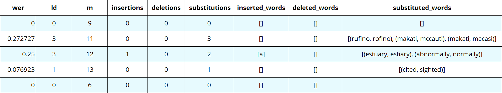
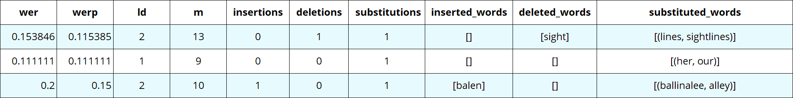

Summarization
=============

This module delivers detailed data summaries for each sequence, encompassing crucial metrics such as Word Error Rate (WER), Levenshtein Distance, and a comprehensive breakdown of insertions, deletions, and substitutions. 

The Summary Modules provides users with a granular understanding of system performance, facilitating quick and detailed error analysis. 
Its detailed insights empower users to swiftly identify and address errors, contributing to a more comprehensive evaluation of the system's strengths and areas for improvement.

summary() counts the insertions, deletions and substitutions on an alignment of the reference and hypothesis words with the fewest edits. When several such alignments exist, it reads the texts from the last word back to the first and takes, at each step, the first move that keeps the fewest edits: a match, a substitution, an insertion, then a deletion. summaryp() uses the same alignment when a substitution weighs exactly the mean of an insertion and a deletion, for example when the three weights are equal. For other weights, summaryp() uses the alignment with the lowest weighted cost, so its counts and word lists can differ from those of summary().

.. note::

   werpy compares words exactly as they are written. Words that differ in case, punctuation or the way a character is stored count as different words. To compare texts from different sources, pass both through normalize() first.

The next two examples return a pandas DataFrame, the default form of the results, and need pandas, which the pandas extra of werpy installs: pip install \"werpy[pandas]\".

Summary Analysis
----------------

*Python Code*

.. code-block:: python

   import werpy
   
   ref = ['it is consumed domestically and exported to other countries', 'rufino street in makati right inside the makati central business district', 'its estuary is considered to have abnormally low rates of dissolved oxygen', 'he later cited his first wife anita as the inspiration for the song', 'no one else could claim that']
   hyp = ['it is consumed domestically and exported to other countries', 'rofino street in mccauti right inside the macasi central business district', 'its estiary is considered to have a normally low rates of dissolved oxygen', 'he later sighted his first wife anita as the inspiration for the song', 'no one else could claim that']
   summary = werpy.summary(ref, hyp)
   print(summary)

*Results Output*

Weighted Summary Analysis
-------------------------

Apply the following weights/penalties to the errors:

- Insertions: 0.5
- Deletions: 0.5
- Substitutions: 1

*Python Code*

.. code-block:: python

   import werpy
   
   ref = ['the tower caused minor discontent because it blocked sight lines of central park', 'her father was an alderman in the city government', 'he was commonly referred to as the blacksmith of ballinalee']
   hyp = ['the tower caused minor discontent because it blocked sightlines of central park', 'our father was an alderman in the city government', 'he was commonly referred to as the blacksmith of balen alley']
   summaryp = werpy.summaryp(ref, hyp, insertions_weight = 0.5, deletions_weight = 0.5, substitutions_weight = 1)
   print(summaryp)

*Results Output*

Results as a polars DataFrame
-----------------------------

With output=\"polars\", summary() and summaryp() return a polars DataFrame with the same columns in the same order. Each substitution is a struct with the fields reference and hypothesis. The polars extra of werpy installs polars: pip install \"werpy[polars]\".

*Python Code*

.. code-block:: python

   import werpy

   ref = ['it was beautiful and sunny today', 'she cited multiple reasons why']
   hyp = ['it was a beautiful and sunny day', 'she sighted multiple reasons why']
   summary = werpy.summary(ref, hyp, output="polars")
   print(summary.select("wer", "ld", "inserted_words", "substituted_words"))

*Results Output*

.. code-block:: text

   shape: (2, 4)
   ┌──────────┬─────┬────────────────┬───────────────────────┐
   │ wer      ┆ ld  ┆ inserted_words ┆ substituted_words     │
   │ ---      ┆ --- ┆ ---            ┆ ---                   │
   │ f64      ┆ i64 ┆ list[str]      ┆ list[struct[2]]       │
   ╞══════════╪═════╪════════════════╪═══════════════════════╡
   │ 0.333333 ┆ 2   ┆ ["a"]          ┆ [{"today","day"}]     │
   │ 0.2      ┆ 1   ┆ []             ┆ [{"cited","sighted"}] │
   └──────────┴─────┴────────────────┴───────────────────────┘

Results as a list of dictionaries
---------------------------------

With output=\"records\", summary() and summaryp() return a list with one dictionary for each pair of texts, whose keys are the columns in the same order. This form works with a plain install of werpy.

*Python Code*

.. code-block:: python

   import werpy

   ref = ['it was beautiful and sunny today']
   hyp = ['it was a beautiful and sunny day']
   records = werpy.summary(ref, hyp, output="records")
   print(records)

*Results Output*

.. code-block:: python

   [{'wer': 0.3333333333333333, 'ld': 2, 'm': 6, 'insertions': 1, 'deletions': 0, 'substitutions': 1, 'inserted_words': ['a'], 'deleted_words': [], 'substituted_words': [('today', 'day')]}]

Long texts
----------

summary(), summaryp(), werp() and werps() can compare long texts, such as the transcripts of a whole meeting. The memory that they use grows with the number of words in the two texts. The time grows with the product of the two numbers of words, so one pair of long texts takes longer than many short pairs with the same number of words.

Overall
-------

The capability of displaying a comprehensive breakdown of word error results within the summary modules offers a profound advantage in the evaluation and analysis of system performance. 
By presenting detailed metrics such as Word Error Rate (WER), Levenshtein Distance, and explicit counts of insertions, deletions, and substitutions, the summary module provides a nuanced understanding of errors on a per-sequence basis. 

This detailed breakdown not only enhances transparency in assessing the system's performance but also facilitates a granular examination of specific error types. 
The inclusion of weighted WER further refines this analysis, allowing for a context-aware evaluation that acknowledges the varying impact of different error categories. 

Such a detailed summary equips practitioners with valuable insights, enabling them to pinpoint areas of strength and weakness in the system, thereby informing targeted improvements and optimizations for enhanced overall performance.
